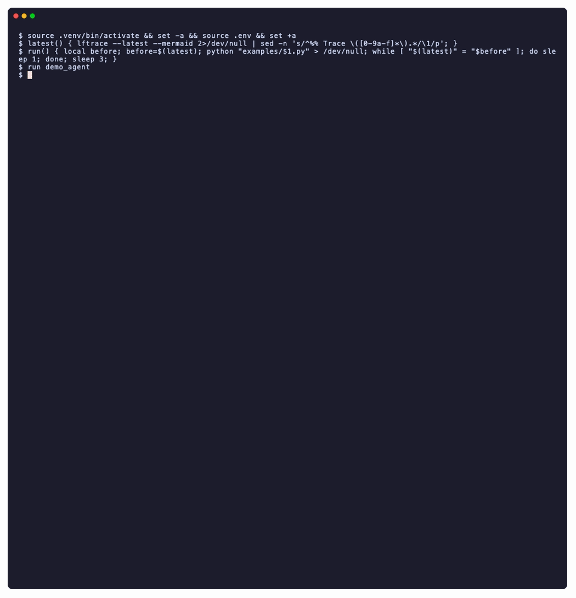

# lftrace

[](https://github.com/fasouto/lftrace/actions/workflows/tests.yml)

Your app's agent leaves a trace in [Langfuse](https://langfuse.com). lftrace turns that
trace into text in your terminal, so you can read it, and so can your coding agent.

```sh
lftrace --latest             # draw the most recent trace
lftrace --latest --mermaid   # the same trace as Mermaid text, for Claude Code or any LLM
```

Paste the `--mermaid` output into Claude Code, or let it run the command itself, and it
sees what your app's agent did: the steps in the order they ran, with durations, tokens,
cost and every error message in full. It doesn't need a screenshot of the Langfuse UI.

lftrace is a prototype. See [Limitations](#limitations) for what it doesn't do yet.



```
$ lftrace --latest
Trace c8747b0761d23f523151d65142f00555 · 1.63s · 132 tokens · $0.00 · 1 warning

                       ┌────────────────────┐      ┌─────────────────────┐
                       │     1. triage      │      │                     │
                       │ GENERATION · 404ms │      │ 2.1. lookup_account │
                  ╭───►│      fake-llm      │ ╭───►│    TOOL · 301ms     │
                  │    │       24 tok       │ │    │                     │
                  │    └────────────────────┘ │    └─────────────────────┘
                  │                           │
                  │                           │
┌───────────────┐ │    ┌────────────────────┐ │    ┌─────────────────────┐   ┌────────────────────┐
│               │ │    │                    │ │    │                     │   │ 2.2.1. embed_query │
│  support-bot  │ │    │  2. billing-agent  │ │    │ 2.2. search_policy  │   │ EMBEDDING · 106ms  │
│ AGENT · 1.63s ├─┼───►│   AGENT · 816ms    ├─┼───►│  RETRIEVER · 308ms  ├──►│   fake-embedding   │
│               │ │    │                    │ │    │                     │   │       8 tok        │
└───────────────┘ │    └────────────────────┘ │    └─────────────────────┘   └────────────────────┘
                  │                           │
                  │                           │
                  │    ┌────────────────────┐ │    ┌─────────────────────┐
                  │    │      3. reply      │ │    │     2.3. refund     │
                  │    │ GENERATION · 406ms │ │    │    TOOL · 206ms     │
                  ╰───►│      fake-llm      │ ╰───►│ ! €29 refund needs  │
                       │      100 tok       │      │      approval       │
                       └────────────────────┘      └─────────────────────┘

! 2.3. refund (TOOL): €29 refund needs approval
```

In a terminal, errors are red and warnings yellow.

`--timeline` draws the same steps as bars on a time axis, so steps that ran at the same
time overlap:

```
$ lftrace --file tests/fixtures/trace.json --timeline
Trace 7f3e0c2a9b1d4e6f8a0b2c4d6e8f0a1b · 6.21s · 2,522 tokens · $0.0005 · 2 errors · 1 warning

   research-agent              │███████████████████████████████████████████████
   1. plan                     │██████
   2. search_docs              │       ███
   2.1. cache-miss             │       ◆
   2.2. vector-search          │       ██
   ✗ 3. get_weather            │          ████████████████
   4. fetch_pages              │          ███████████████████████████
   4.1. fetch_page_1           │          ██████
   4.2. fetch_page_2           │          █████████
   4.3. fetch_page_3           │           ███████████
   4.4. fetch_page_4           │           █████████████
   ✗ 4.5. fetch_page_5         │           ████████████████
   4.6. fetch_page_6           │           ██████████████████
   4.7. fetch_page_7           │           █████████████████████
   4.8. fetch_page_8           │           ███████████████████████
   4.9. fetch_page_9           │           ██████████████████████████
   ! 5. answer                 │                                     █████████
   6. format "final" [answer]… │                                              █
                               └┬──────────────┬──────────────┬──────────────┬─
                               0s             2s             4s             6s

✗ 3. get_weather (TOOL): TimeoutError: weather API timed out after 2s
✗ 4.5. fetch_page_5 (TOOL): HTTP 503 from example.org
! 5. answer (GENERATION): answered without weather data
```

## Install

```sh
uv tool install git+https://github.com/fasouto/lftrace   # puts lftrace on your PATH
```

Or, from a clone of this repo, run it in place with `uv run lftrace`. It needs Python
3.10 or later.

## Quick start

Run the demo agent (it needs only Langfuse keys, no LLM key), then look at its trace:

```sh
export LANGFUSE_PUBLIC_KEY=pk-lf-... LANGFUSE_SECRET_KEY=sk-lf-... LANGFUSE_HOST=https://cloud.langfuse.com
uv run examples/demo_agent.py
uv run lftrace --latest
```

If you'd rather keep the keys in a file, `cp .env.example .env`, fill it in, and use
`uv run --env-file .env ...`. A new trace can take a few seconds to show up.

`examples/` has three fake agents to try it on. Each one sends a trace with a different
shape:

- `demo_agent.py`: a trip planner for a rainy day in Lisbon. A weather call times out and
  the agent retries it. A retriever finds places and a tool checks their opening hours.
  The weather lookup and the place finding run at the same time, and so do the opening
  hours checks. A writer sub-agent drafts the day, a guardrail flags a place with no
  opening hours, and the writer revises.
- `support_bot.py`: a support bot hands a billing question to a sub-agent, which looks up
  the account and searches the refund policy at the same time, then asks for a refund
  that needs a human's approval.
- `coding_agent.py`: a coding agent needs five attempts to fix a failing test. lftrace
  folds the middle attempts into `+3 more` and counts their errors. The attempts run one
  after another, so its timeline has no overlap.

They need only Langfuse keys. With `OPENROUTER_API_KEY` set, their LLM steps are real calls
through [OpenRouter](https://openrouter.ai).

## With a coding agent

In Claude Code, `!` runs a command and adds its output to the conversation:

```
> !lftrace --latest --mermaid
> Why did get_weather fail the first time, and why does the fact-check warn about Tram 28?
```

The Mermaid output starts with `%%` comment lines that have the totals and every error and
warning in full, so your agent still sees a message that a box cut short. It's still valid
Mermaid, so you can also paste it into a Mermaid viewer such as
[mermaid.live](https://mermaid.live).

## Usage

```
lftrace <trace_id>           show a trace
lftrace --latest             show the most recent trace (from the last 7 days)
lftrace --file trace.json    show a trace saved as JSON, without network

  --mermaid    print the Mermaid source instead of the drawing
  --timeline   draw the steps on a time axis instead of as a tree
  --sequence   draw who called whom, in the order they ran
  --depth N    show only the first N levels
```

The header has the trace's totals: duration, tokens, cost, errors and warnings. Each box is
one step, with arrows from each step to the steps it ran, left to right. lftrace numbers
steps in the order they ran, so `2.1` is the first step inside step 2. A box shows the
step's name, type and duration. For LLM calls it also shows the model, tokens and cost
when Langfuse has them. A failed step ends with `✗` and the start of its message, and a
warning with `!`. The full messages are under the diagram.

A step with more than three children shows the first and the last, with a `+N more` box
in between, and `--depth` folds deeper levels into a `+N nested` line. Those boxes still
count the errors and warnings they hide, and the list under the diagram has them with
their step numbers.

`--timeline` shows each step as a bar on a time axis that starts at the trace's start, so
parallel steps overlap. A row has the step's number, name and a bar from its start to its
end. It shows every step, not just the first and last, and `--depth` folds levels as in the
tree. An event is a `◆`, and a step with no end time runs to the end of the chart. A failed
step starts with `✗` and a warning with `!`. With `--mermaid` it prints a Mermaid gantt
chart.

`--sequence` draws who called whom, in the order they ran, as a Mermaid sequence diagram.
Each lane is an agent, a model or the shared `tools` lane. The first lane is the trace's
root, or a `trace` lane when the trace has several roots or a single step. A root that
is an agent keeps its agent lane, and any other root gets a lane named after it. A root
that failed or has a warning gets a note after its children. A step is an arrow from the
lane that called it, and a dashed return arrow with its duration, tokens, cost and
status. A failed step's return arrow ends in `x` and has its message. Work that has no
lane of its own, such as a plain span or an event, is an arrow from a lane to itself.

Steps that ran at the same time are in a `par` block, one branch each, and a branch for a
wrapper span has the span's number and name as its label. Retries of the same step are in
a `loop` block that counts the failed ones. Like the tree, a run of more than three shows
its first and last with a `+N more` note in between, and the note counts the errors it
hides. Three or more parallel calls or self-messages with the same name fold into one
call, such as `2.3.1–2.3.5. check_hours ×5`. Its return has the slowest duration and
counts every error and warning. Wrapper spans don't fold. `--depth` folds levels into
`+N nested` on the return arrow. With `--mermaid` it prints a Mermaid sequence diagram.

```
$ lftrace --latest --sequence
Trace 5cd8640a116790e88950c226f6fd21c3 · 1.32s · 132 tokens · $0.00 · 1 warning

 ┌─────────────┐      ┌───────────────┐ ┌──────────┐  ┌────────────────┐           ┌───────┐
 │ support-bot │      │ billing-agent │ │ fake-llm │  │ fake-embedding │           │ tools │
 └─────────────┘      └───────────────┘ └──────────┘  └────────────────┘           └───────┘
        ┆ 1. triage           ┆               ┆                ┆                       ┆
        ──────────────────────────────────────►                ┆                       ┆
        ┆ 405ms · 24 tok      ┆               ┆                ┆                       ┆
        ◄┄┄┄┄┄┄┄┄┄┄┄┄┄┄┄┄┄┄┄┄┄┄┄┄┄┄┄┄┄┄┄┄┄┄┄┄┄┄                ┆                       ┆
        ┆ 2. billing-agent    ┆               ┆                ┆                       ┆
        ──────────────────────►               ┆                ┆                       ┆
        ┆                     ┆               ┆                ┆                       ┆
        ┆                   ┌────────────────────────────────────────────────────────────┐
        ┆                   │[par]                                                       │
        ┆                   │ ┆ 2.1. lookup_account            ┆                       ┆ │
        ┆                   │ ─────────────────────────────────────────────────────────► │
        ┆                   │ ┆ 301ms         ┆                ┆                       ┆ │
        ┆                   │ ◄┄┄┄┄┄┄┄┄┄┄┄┄┄┄┄┄┄┄┄┄┄┄┄┄┄┄┄┄┄┄┄┄┄┄┄┄┄┄┄┄┄┄┄┄┄┄┄┄┄┄┄┄┄┄┄┄┄ │
        ┆                   │ ┆               ┆                ┆                       ┆ │
        ┆                   │┄┄┄┄┄┄┄┄┄┄┄┄┄┄┄┄┄┄┄┄┄┄┄┄┄┄┄┄┄┄┄┄┄┄┄┄┄┄┄┄┄┄┄┄┄┄┄┄┄┄┄┄┄┄┄┄┄┄┄┄│
        ┆                   │ ┆ 2.2. search_policy             ┆                       ┆ │
        ┆                   │ ─────────────────────────────────────────────────────────► │
        ┆                   │ ┆               ┆                ┆ 2.2.1. embed_query    ┆ │
        ┆                   │ ┆               ┆                ◄──────────────────────── │
        ┆                   │ ┆               ┆                ┆ 101ms · 8 tok         ┆ │
        ┆                   │ ┆               ┆                ┄┄┄┄┄┄┄┄┄┄┄┄┄┄┄┄┄┄┄┄┄┄┄┄► │
        ┆                   │ ┆ 302ms         ┆                ┆                       ┆ │
        ┆                   │ ◄┄┄┄┄┄┄┄┄┄┄┄┄┄┄┄┄┄┄┄┄┄┄┄┄┄┄┄┄┄┄┄┄┄┄┄┄┄┄┄┄┄┄┄┄┄┄┄┄┄┄┄┄┄┄┄┄┄ │
        ┆                   │ ┆               ┆                ┆                       ┆ │
        ┆                   └────────────────────────────────────────────────────────────┘
        ┆                     ┆ 2.3. refund   ┆                ┆                       ┆
        ┆                     ─────────────────────────────────────────────────────────►
        ┆                     ┆ 200ms · ! €29 refund needs approval                    ┆
        ┆                     ◄┄┄┄┄┄┄┄┄┄┄┄┄┄┄┄┄┄┄┄┄┄┄┄┄┄┄┄┄┄┄┄┄┄┄┄┄┄┄┄┄┄┄┄┄┄┄┄┄┄┄┄┄┄┄┄┄┄
        ┆ 515ms               ┆               ┆                ┆                       ┆
        ◄┄┄┄┄┄┄┄┄┄┄┄┄┄┄┄┄┄┄┄┄┄┄               ┆                ┆                       ┆
        ┆ 3. reply            ┆               ┆                ┆                       ┆
        ──────────────────────────────────────►                ┆                       ┆
        ┆ 401ms · 100 tok     ┆               ┆                ┆                       ┆
        ◄┄┄┄┄┄┄┄┄┄┄┄┄┄┄┄┄┄┄┄┄┄┄┄┄┄┄┄┄┄┄┄┄┄┄┄┄┄┄                ┆                       ┆
        ┆                     ┆               ┆                ┆                       ┆

! 2.3. refund (TOOL): €29 refund needs approval
```

### Credentials

lftrace reads `LANGFUSE_PUBLIC_KEY`, `LANGFUSE_SECRET_KEY` and `LANGFUSE_HOST` (EU cloud,
`https://cloud.langfuse.com`, if unset). Like the Langfuse SDK, it also accepts
`LANGFUSE_BASE_URL`, and uses it when both are set. It only reads data and never prints
the keys.

### Saving a trace

`--file` takes the JSON that the Langfuse API returns for a trace's observations, so you
can save one with curl:

```sh
curl -s -u "$LANGFUSE_PUBLIC_KEY:$LANGFUSE_SECRET_KEY" \
  "$LANGFUSE_HOST/api/public/v2/observations?traceId=<trace_id>&fields=core,basic,model,usage&limit=1000" \
  > trace.json
lftrace --file trace.json
```

## How it works

1. Fetch the trace's observations with the Langfuse Python SDK
   (`api.observations.get_many(trace_id=...)`, all pages).
2. Build a tree from each observation's parent id, with siblings ordered by start time.
3. Write it as a left-to-right Mermaid flowchart, with `--timeline` as a gantt chart, or
   with `--sequence` as a sequence diagram (`--mermaid` shows it).
4. Draw it with [Termaid](https://github.com/fasouto/termaid) (`termaid.render_rich()`).

lftrace works with Langfuse Cloud and recent self-hosted Langfuse versions (it uses the
v2 observations API). On Python 3.10 it installs Langfuse SDK v4, and on 3.11 or later it
installs v5.

## Limitations

lftrace is a prototype. Before it's ready for production, Termaid, the library that
draws the diagrams, needs a few changes: drawing steps with many children without
crossing lines, reading `<br>` line breaks in labels, coloring label text, and keeping the
spaces in a sequence label where it crosses a lifeline. Until then, lftrace works around
them, and some of the limits below come from that.

- **Three children per step in the tree.** A step with more children shows the first and
  the last, with `+N more` in between, because Termaid 0.10.0 draws stray lines when a
  node has more than three children. lftrace still counts and lists the errors and
  warnings in the hidden steps. `--timeline` shows every step.
- **Deep traces get wide.** Each level adds about 35 columns, so four levels fit in 120.
  For deeper traces, use a wider terminal or `--depth`.
- **A fixed width for the timeline.** Termaid 0.10.0 draws gantt charts 80 columns wide,
  whatever the terminal, so names are cut at 24 characters and short steps in a long trace
  can be a single block.
- **No inputs, outputs or scores.** The diagram shows each step's place in the tree, its
  timing, tokens, cost and status. Open the trace in Langfuse for the rest.
- **Short labels.** Boxes cut names at 40 characters and messages at 30. The full
  messages are under the diagram and in the `--mermaid` comments.
- **Wide sequence diagrams.** Each agent and each model gets its own lane, so traces with
  many of them get wide. The tools share one lane. A long label widens the gap between the
  two lanes it joins.
- **`\n` line breaks.** Labels break lines with `\n` because Termaid 0.10.0 doesn't read
  `<br>`. mermaid.live and GitHub show them as line breaks, but some viewers show `\n`
  as text.
- **`--latest` looks back 7 days**, and a new trace can take a few seconds to show up.

## Development

```sh
uv sync
uv run pytest
uvx ruff check && uvx ruff format --check
```

The tests use a saved trace (`tests/fixtures/trace.json`) and a fake HTTP server, so they
don't need a network connection or keys.

[vhs](https://github.com/charmbracelet/vhs) records the GIF. `vhs docs/demo.tape` runs the
three examples against the Langfuse project in your `.env` and writes `docs/demo.gif`.

## License

MIT
